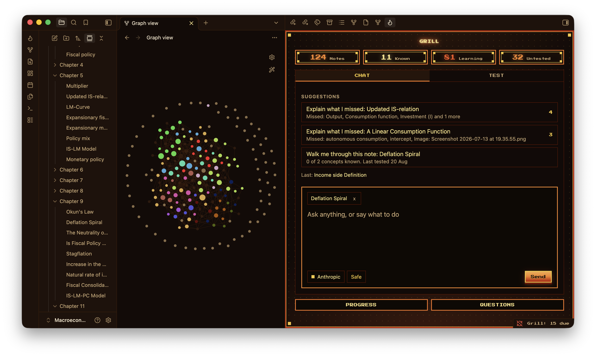
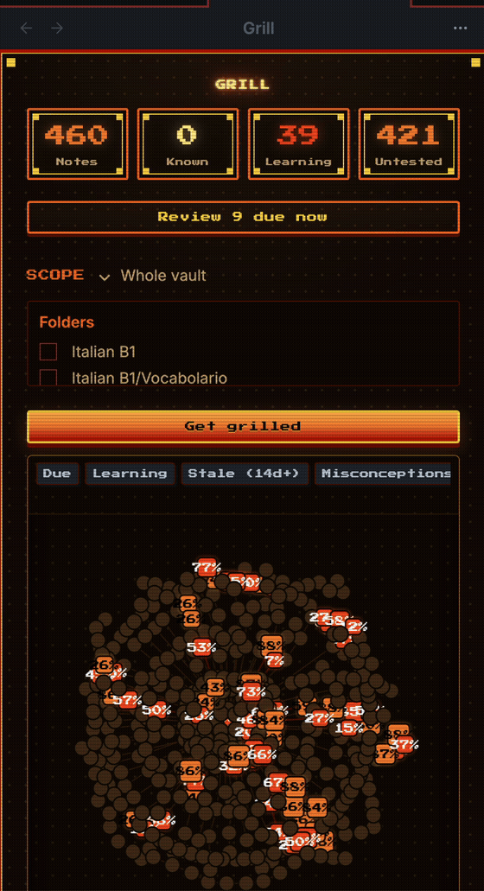
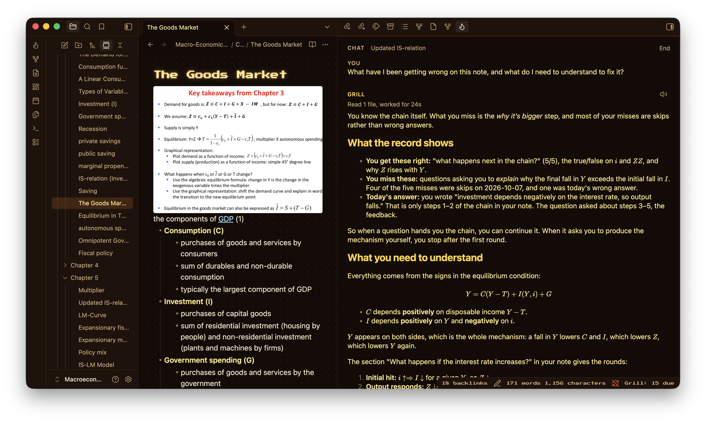
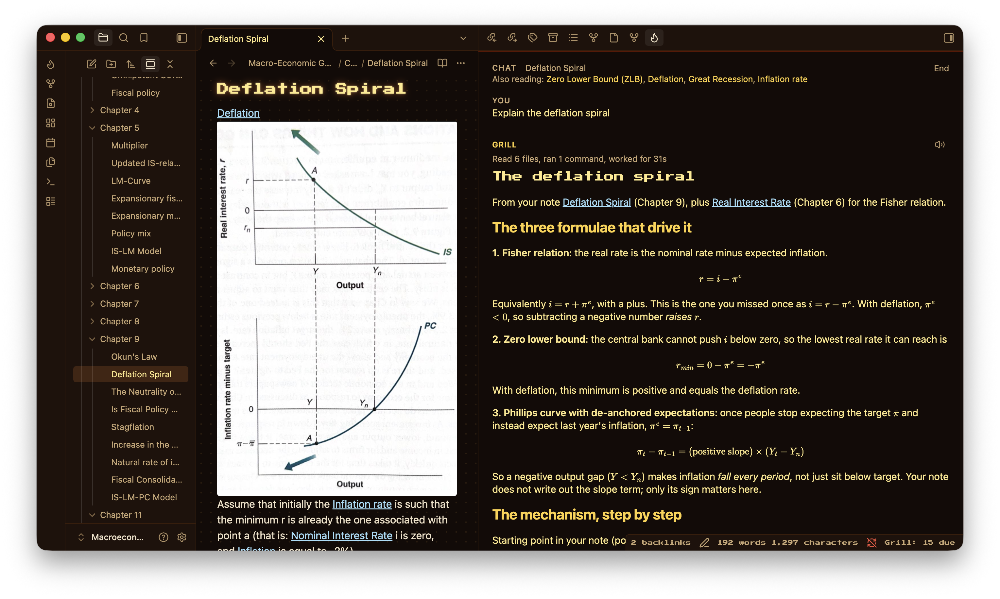
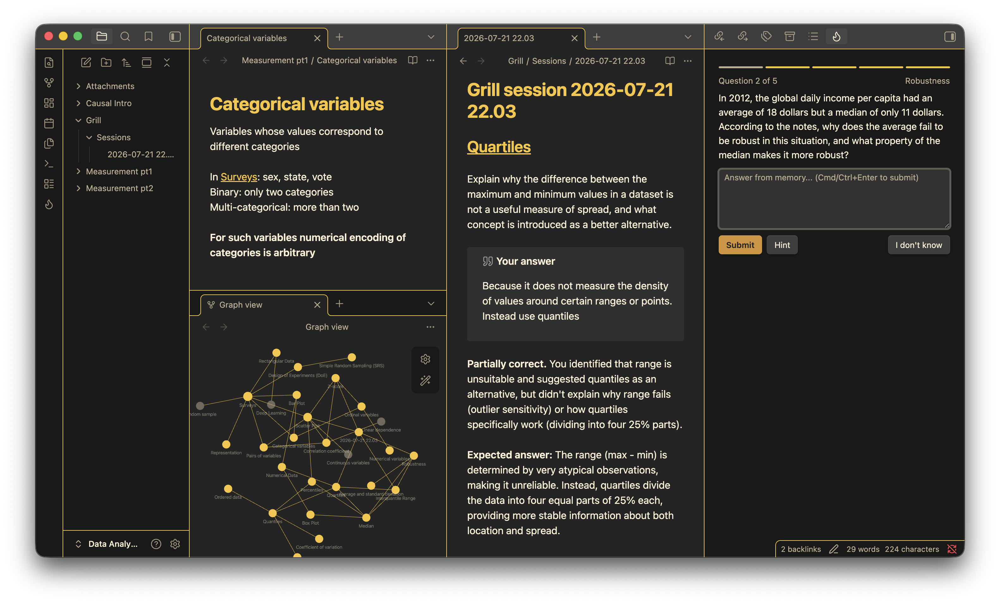

I take a lot of notes to learn new material, and I needed a way to learn them more deeply. Grill is a chat that works inside your Obsidian vault and keeps a record of what you know. It tests you on your own notes, grades what you write, and schedules each concept with spaced repetition. In turn, the chat answers from that record: it knows which questions you missed, which you skipped, and what you asked about last week.



<p align="center"></p>

## <picture><source media="(prefers-color-scheme: dark)" srcset="docs/icons/play-dark.svg"></picture> How to use it

1. **Start free.** On first run, press Start free. That is Grill Cloud: no API key, no sign-up, and a few free credits to try it. You can use your own API key, Ollama, Claude Code or Codex instead.
2. **Chat.** Ask about the note you have open, or tell Grill what to do with it. It can explain, summarise, find things across the vault, and edit or create notes, asking your permission before a change.
3. **Test.** Switch to Test and press **Get grilled**. Grill writes questions from your notes and marks what you type back, with partial credit and specific feedback. What you get wrong is what Chat and the suggestions point at next.

The home screen suggests where to go from your record: the questions you last missed, the notes not yet tested, the note you have open. Specifically, each suggestion states a fact (how many concepts are known, what was missed last time) and leaves the choice of what matters to you.



##  What you get

- **A chat that works in your vault:** it reads, searches, edits and creates notes over several steps, and shows each step as it happens. Three permission levels decide when it has to ask: Safe, Plan and Auto.
- **A record behind every reply:** per-concept scheduling, your past answers and the confusions Grill has named are given to the chat, so an explanation starts from what you got wrong.
- **Nothing to set up:** [Grill Cloud](#grill-cloud) answers, writes questions and grades with no API key and no account. Free to try.
- **Or your own subscription:** [Claude Code or Codex](#with-claude-code-or-codex), run from the program already installed on your computer with your own sign-in.
- **Or your own key:** Claude, GPT, Gemini, DeepSeek, any OpenAI-compatible endpoint (OpenRouter, Groq, LM Studio), or a local model through Ollama.
- **Questions from your own notes:** recall questions written from what you wrote, in free text, multiple choice, true or false, fill-in and matching.
- **Fair grading:** answers are marked against a rubric written with the question, with partial credit and the expected answer always shown.
- **Ask in the middle of a test:** type a question in the answer box and Grill answers it; the record notes that you needed help.
- **Replies as they are written:** Chat streams its answer, and a reply can be inserted at the cursor or saved as a note.
- **A map of what you know:** on the Progress screen, your notes as a graph coloured by how well you know each.
- **A natural voice:** questions, feedback and explanations read aloud in a natural AI voice on Grill Cloud or an OpenAI key, or in your device's voice anywhere.
- **Finds links you are missing:** spots notes that belong together and offers to add the `[[link]]`.
- **Works with the cards you already have:** Spaced Repetition's `==cloze==` and `::`/`?` cards and Anki's `{{c1::…}}` clozes are used as they are.
- **Your own questions:** a `> [!grill]` callout in any note is asked verbatim.
- **Every question editable:** the Questions screen lists what was last missed and everything Grill has written, for fixing in place.
- **Reads embedded PDFs:** a `![[worksheet.pdf]]` embed is read and quizzed on like any other note content.
- **Real spaced repetition:** FSRS scheduling per concept; edit a note and only the changed parts re-open.
- **A theme to match:** [Grill, the theme](https://github.com/theadamdanielsson/grill-theme) puts the rest of Obsidian in the same colours, dark and light.

How each of these works is described in **[docs/features.md](docs/features.md)**.





<a name="grill-cloud"></a>
## <picture><source media="(prefers-color-scheme: dark)" srcset="docs/icons/cloud-dark.svg"></picture> Grill Cloud

Grill Cloud is the easiest way to use Grill. Press Start free and it answers in Chat, writes the questions, grades your answers and explains them, with no API key and no sign-up. Grill makes a key on your device and, while each day's free credits last, you get some to try it.

After that you buy credits when you want them: 400 for $3.99 or 1,100 for $9.99, plus tax where it applies. You pay once per pack. How many credits a session uses depends on how long your notes are and how much you ask of it. Importantly, a Chat turn that works in the vault takes several steps, and each step is charged as a reply, so editing through Chat costs more than asking a question. Grill tells you what each finished session used. Credits appear in Grill a few seconds after you pay, and they do not expire. The checkout is run by Stripe, so the page says "Sold through Link" and your card statement shows Link. Buying happens in Grill's settings and nowhere else.

It runs on Claude Sonnet 5.5, the model Grill recommends for grading.

One thing differs from every other way of running Grill. With Grill Cloud, the notes in a session, the images in them, your answers and your custom instructions go through my server to Anthropic. In Chat, the notes the model asks to read go the same way. My server does not keep them: it does not store or log your notes, the questions, or your answers. Anthropic keeps them for up to 30 days to watch for abuse and does not train on them. If you turn on the natural voice, the text being read aloud goes to OpenAI the same way. What my server does store is a short list, set out in the privacy policy.

- [Privacy policy](https://grill.onbridger.com/privacy)
- [Terms](https://grill.onbridger.com/terms)

There is nothing to look after. Grill makes a key on your device when you press Start free, and that key is your balance. Every vault on the same device shares it, and it follows a synced vault to your other devices. If you ever lose them all, email inquiries@onbridger.com from the address you paid with and I will move your purchased credits to your new install. Settings has the rest under Account, including a Delete account button that erases your balance and usage from my server.

Used credits cannot be refunded. Unused ones can if you ask within 14 days. Grill Cloud is for people 18 and over.

<a name="with-claude-code-or-codex"></a>
## <picture><source media="(prefers-color-scheme: dark)" srcset="docs/icons/screen-dark.svg"></picture> With Claude Code or Codex

Chat can run on the Claude Code or Codex already installed on your computer. Grill starts the program as it is, in your vault, and shows what it does; the sign-in is the one you made in a terminal, and Grill never sees it. As a result, Chat draws on the plan you already pay Anthropic or OpenAI for, within whatever that plan allows for use outside the provider's own apps.

The button under the chat box steps through the engines found on your computer, and the button beside it sets the permission level. Safe asks before a note is changed or a command is run. Plan reads and proposes, and changes nothing. Auto edits notes in the vault without asking. These are the programs' own permission systems, passed through; Grill adds none of its own.

Two limits apply. First, this works on desktop only, since there is a program to run. Second, these engines answer in Chat; tests are still written and graded by Grill Cloud, your own key or Ollama.

## <picture><source media="(prefers-color-scheme: dark)" srcset="docs/icons/key-dark.svg"></picture> With your own key

To pay a model provider directly, pick "use my own API key or Ollama" on first run, or choose a provider in settings. Grill works the same on Claude, GPT, Gemini, DeepSeek or any OpenAI-compatible endpoint, and on a local model through Ollama, where nothing leaves your machine. Your notes go straight from your machine to the provider you chose; my server is not involved. On Anthropic, OpenAI, DeepSeek and OpenAI-compatible endpoints, Chat can also read, search and change notes. Which model to pick is covered in [docs/models.md](docs/models.md).

## <picture><source media="(prefers-color-scheme: dark)" srcset="docs/icons/page-dark.svg"></picture> Documentation

- **[docs/features.md](docs/features.md)**: how Chat, the permission levels, scheduling, the record, custom questions and PDFs work.
- **[docs/privacy.md](docs/privacy.md)**: what leaves your machine, where it goes, and what Grill stores.
- **[docs/models.md](docs/models.md)**: which model to use, by budget and by how much RAM your machine has.
- **[docs/troubleshooting.md](docs/troubleshooting.md)**: the mechanics behind the common "is this a bug" questions.

## <picture><source media="(prefers-color-scheme: dark)" srcset="docs/icons/ask-dark.svg"></picture> Worth knowing before you install

- Grill needs a model: [Grill Cloud](#grill-cloud), your own API key, or Ollama. Earlier versions had a mode with no AI; 8.0 removes it.
- It is only as good as your notes. Half-written notes make half-baked questions.
- The grading is a model's judgement. It is usually right, and it always shows you the expected answer so that you can judge for yourself.
- A chat that can edit your notes can edit them badly. Safe is the default level, every change is shown before it is made, and a vault under version control or sync history can undo one.
- Local models are the weak link: good for privacy, weaker on questions and grading.

## <picture><source media="(prefers-color-scheme: dark)" srcset="docs/icons/check-dark.svg"></picture> Requirements

- **Obsidian 1.8.0 or newer.** Grill checks this on load and won't run on an older build.
- **Desktop or mobile.** Writing long answers is easier with a keyboard, and Claude Code and Codex are desktop only.
- **One of these, for questions and grading:**
  - [Grill Cloud](#grill-cloud): nothing to install or sign up for. Press Start free.
  - An API key from Anthropic, OpenAI, Google, DeepSeek, or any OpenAI-compatible endpoint (OpenRouter, Groq, LM Studio).
  - [Ollama](https://ollama.com) installed locally: no key, no cost, nothing leaving your machine.
- **Optionally, for Chat:** Claude Code or Codex installed and signed in.
- No account with Grill itself.

## <picture><source media="(prefers-color-scheme: dark)" srcset="docs/icons/install-dark.svg"></picture> Installation

Website: [grill.onbridger.com](https://grill.onbridger.com)

**From Obsidian (recommended):** Settings → Community plugins → Browse, search "Grill", Install, then Enable. If Community plugins are off, Settings → Community plugins → turn on "Turn on community plugins" first.

**Manual install (a specific version, or before it's live in the community list):** download `main.js`, `manifest.json`, and `styles.css` from a [release](https://github.com/theadamdanielsson/grill/releases) and place all three in `<vault>/.obsidian/plugins/grill/` (create the folder if it doesn't exist), then reload Obsidian and enable Grill in Community plugins. [BRAT](https://github.com/TfTHacker/obsidian42-brat) automates this if you want to track updates without waiting for the community list.

**Build it yourself:**

```sh
npm install
npm run build
```

then drop `main.js`, `manifest.json`, and `styles.css` into `<vault>/.obsidian/plugins/grill/`.

After installing, open Grill (the flame icon, or the "Open Grill" command). First run asks how your questions should be written, then starts you on the note you have open.

## <picture><source media="(prefers-color-scheme: dark)" srcset="docs/icons/cross-dark.svg"></picture> Troubleshooting

The common ones are below; the full list is in [docs/troubleshooting.md](docs/troubleshooting.md).

- **"Couldn't find concepts to quiz in these notes."** The note has too little in it to ask about. Add to it, or pick a longer note.
- **Chat says it cannot edit my notes.** The engine answering has no tools: Gemini and Ollama answer in text only. Switch the engine under the chat box, or use Grill Cloud, an Anthropic or OpenAI key, Claude Code or Codex.
- **The engine button opens settings.** No installed Claude Code or Codex was found. Set its location in Grill's settings.
- **A note I aced does not turn green.** Green requires most of a note's concepts to each be answered correctly twice, spaced out. One pass is not enough to call a note known.
- **The same question keeps coming back.** This is by design: a concept's question is written once and reused on every later review, so that what is tested is the answer and never the wording. The "Clear cached questions" command forces a new one.
- **A model is not reading the images in my notes.** Grill sends images to models that support vision, and says in the session when the chosen model cannot read them.
- **A PDF is not being quizzed on.** Check that it is embedded, `![[file.pdf]]` with the `!`. A scanned PDF with no text layer, or a password-protected one, has nothing for Grill to extract.
- **API errors, or grading looks wrong.** Check the key and the model name in settings; a mistyped model ID is the usual cause.

Something broken? [Open an issue](https://github.com/theadamdanielsson/grill/issues). A question or an idea? [Start a discussion](https://github.com/theadamdanielsson/grill/discussions).

## Privacy and cost

Grill talks only to the model provider you configure. There are no analytics, there is no account, and no server of mine sits in the middle. The one exception is [Grill Cloud](#grill-cloud), if you turn it on: the session then goes through my server to Anthropic. What leaves your machine and what Grill stores locally is set out in **[docs/privacy.md](docs/privacy.md)**.

## License

MIT

<picture><source media="(prefers-color-scheme: dark)" srcset="docs/fire-dark.svg"></picture>
