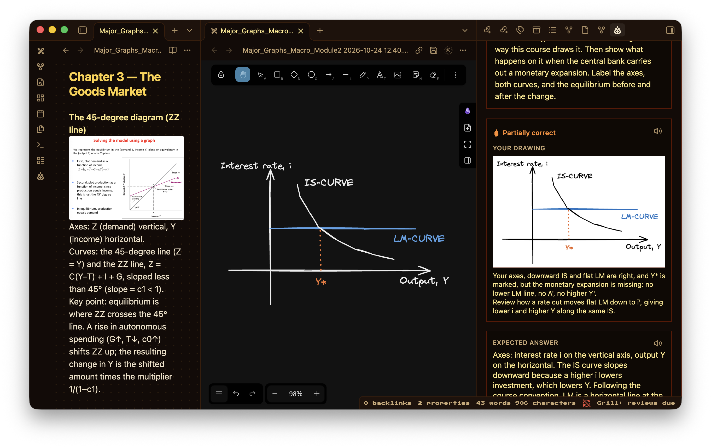

# Features

How Grill's features work. The [README](../README.md) covers what Grill is and how to start; this page gives the detail.

## Chat

Chat is a conversation about your notes in which nothing is graded. It opens on the note you have beside it, shown as a chip on the message that you can remove, and it answers from four sources: that note, the notes it links to or that match your words, a map of every note in the vault, and Grill's record of how you have done. Every chat, including one with no note attached, begins with a digest of the whole record: how many concepts are tested and known, what is due, the weakest concepts with what you last wrote on each and why it was marked down, the confusions that still show in your recent answers, and those you have fixed. Specifically, the weakest concepts are ranked towards the note the chat is about and the notes linked to it, and the digest is cut to a fixed size, so it costs the same however large the vault grows. With a note, the record also carries how each of its concepts has gone, what you answered on it in past sessions and how it was marked, and what you have asked about before. A reply can therefore begin from the step you keep missing, which a general explanation would have no way of knowing. When you move to another note during a conversation, each message also tells the model which note is open in the editor at that moment.

A question about the vault as a whole is answered from the vault's own structure. On an engine that can read notes, Grill sends a map built from Obsidian's index: every note, folder by folder, with its main headings, the notes it links to, how many notes link to it, its tags and how you have done on it. The model then looks closer with a tool that outlines a note without reading it, giving its headings, its links in both directions, its tags and its properties, and it reads in full only the notes the answer needs. As a result, a conversation about the whole vault costs about as much per message as one about a single note, and it can run as long. An engine without tools is sent as many notes in full as fit instead, and such a conversation is kept to six questions.

Chat can also act. Where the engine supports it, the model may read a note, search the vault, list notes, change part of a note, rewrite a note, or create one. Each of these is listed above the reply as it happens, and a finished reply carries one line summing them up. In turn, a change to a note passes through a permission card that shows the lines to be removed and the lines to be added, with three answers: Allow once, Always allow in this chat, and Deny.

Three levels decide when the card appears. Safe asks before any change to a note and before any command. Plan lets the engine read and propose, and nothing is changed. Auto lets it edit notes in the vault without asking. The level is set with the button beside the engine's name under the chat box, which stays under the box inside a conversation too, beside the model. An engine changed in the middle of a conversation is given the conversation so far with the next message.

A turn that changed notes ends with a list of them, each a way into the note, and one Undo that puts all of them back as they were before the turn. A note changed again since, by hand or by a later turn, is left as it is, and Grill says so. Undo is available on Grill Cloud, keys of your own and Claude Code; Codex and opencode make their changes without Grill seeing the text beforehand.

The digest is written by Grill from the record each time and never by the model. A confusion counts as open while it appears in one of your last three answers on a concept, and as fixed once those answers no longer show it. Evidence is given in words, such as "recall weak", and never as a probability. When the digest is not enough, Chat reads more of the record through tools of its own: what you got wrong or only partly right last time, what you know of a topic, and how the record stands overall. When it recommends studying something, it offers it as a button under the reply, which starts the test there and then: the reviews due, a retry of what you missed, or a test on the notes it names. Chat does not quiz you itself. Testing belongs in Test, where answers are graded and scheduled.

A reply is written to the screen as the model produces it. Under each reply, Insert at cursor places it in the note you are editing and Save as note keeps it as a note of its own beside the one it was about. Every conversation is saved under `Grill/Learn/`, and Test me on this starts a test on the note the conversation concerned.

The Chats link on the home screen lists every saved conversation, newest first, with a search box. Opening one continues it: the earlier turns return, and what is said next is added to the same note. Moreover, a conversation can be renamed, which changes its title, its heading and its file name while keeping the date at the front, or deleted, which moves its note to the trash set in Obsidian.

A conversation can run for as long as it is wanted. On Grill Cloud and keys of your own, the conversation is sent again with each message, so once it grows long its start is summed up in a single model call and the latest turns are kept word for word, in the way Claude Code compacts a conversation. A summary that has grown long is summed up again with what followed it. The saved note keeps every turn, and only what is sent to the model is shortened. Claude Code, Codex and opencode keep their own conversation and compact it themselves.

Chat can be started from text selected in a note. A right-click on the selection opens a Grill entry with four actions, which are also in the command list: Ask about this holds the passage above the chat box for a question to be typed, Explain and Rewrite send at once, and Make a note asks for a note written from the passage. In turn, the two actions under each reply complete the last two, since Insert at cursor replaces the text still selected and Save as note keeps the reply as a note of its own.

A saved prompt is a note in `Grill/Prompts/`, named for what it does, whose text is sent as written. The command New saved prompt creates one, and Run a saved prompt sends one in a Chat about the open note, with any selected text quoted beneath it or placed where the prompt says `{{selection}}`. Once a prompt exists, a Prompts button under the chat box places one in the box, where it can be changed before it is sent.

Two characters typed in the box open a list. `@` lists your notes; the one picked goes in as a `[[link]]`, and its text is read with the message. `/` at the start lists the prompts, and, when Chat runs on Claude Code, your own Claude Code commands and skills, marked as such.

## Engines

An engine is what answers in Chat, and the button under the chat box steps through the ones available. Four kinds exist. Grill Cloud needs no setup and runs on a monthly plan once the free credits are used. A key of your own sends requests straight to the provider you chose. Claude Code, Codex and opencode run the program installed on your computer, under the sign-in you made there, with the vault as the working folder. Grill can install opencode, whose free models need no account. Ollama runs a model on your own machine.

Where an engine offers a choice of model, a second button under the chat box names the model in use and opens the list. With a key of your own, the list is the one on your account, and the model chosen there also writes and marks tests. With Claude Code, the choice is among its default, Opus, Sonnet and Haiku. Grill Cloud and Codex offer no choice here.

The engines differ in what they can do in the vault. Grill Cloud and keys for Anthropic, OpenAI, DeepSeek and OpenAI-compatible endpoints use Grill's own note tools, which the plugin carries out through Obsidian; these work on a phone as on a desktop, and they cannot reach into Grill's own folder. Beyond the vault, these engines reach only what is set up under [Tools, skills and the web](#tools-skills-and-the-web). Claude Code, Codex and opencode bring their own tools, shell commands included, and their own permission systems, which Grill passes through unchanged; they run on desktop only. They also bring the rest of your own setup, as in a terminal: skills, MCP servers, hooks and instructions such as `CLAUDE.md`. Grill gives each of them its record tools in addition, in the way each program accepts them: inside the plugin for Claude Code, as Codex's own dynamic tools, and for opencode as an MCP endpoint on your computer that is open only for the turn. Gemini and Ollama answer in text and change nothing.

Tests are a separate matter. Questions are written and graded by Grill Cloud, your own key or Ollama, whichever is chosen as the provider in settings. Only when none of these is set up are tests written and graded by the program Chat runs on.

## Tools, skills and the web

Chat on Grill Cloud and on keys of your own can use more than the vault. Four additions are set in Settings → Agents → Tools and skills, and the model decides when to use each of them, as Claude Code does. Claude Code, Codex and opencode bring their own versions of all four.

MCP servers give Chat the tools of other programs and services. They are written as in Claude Code's `.mcp.json`: a `command`, with its `args` and `env`, for a program on your computer, or a `url`, with any `headers`, for a server on the web. Import from Claude Code copies the servers that Claude Code and Claude Desktop already have, leaving out Grill's own. Since a server's settings can hold its keys, the list is kept in Obsidian's keychain on that device and does not travel with the vault. Connect then lists each server with the number of tools it offers, or the reason it could not be reached. A server that requires an account shows Sign in. The button opens the service's sign-in page in your browser, and the browser returns to Grill through a one-time address on your computer (`127.0.0.1`) on desktop, or through an `obsidian://` link on a phone. The sign-in is then kept in Obsidian's keychain on that device and renewed when it runs out; Chat never opens a browser by itself. A server on the web works on any device, whereas one that runs as a program needs a desktop.

In turn, an MCP tool follows the permission levels. A tool its server marks as read-only runs without asking. Any other asks first at Safe, with what it will be sent shown on the card, and is refused at Plan.

Skills are instructions for kinds of work, in the Agent Skills format that Claude Code, Codex and opencode share. Grill reads them from `Grill/Skills/` in the vault and, on desktop, from `~/.agents/skills` and `~/.claude/skills`, so a skill added with `npx skills add` is found without further setup. The model is told each skill's name and description, and it loads a skill in full, together with any file the skill points to, when a request fits it. A skill's scripts are read for what they say and are never run.

The web is reached in two ways. First, Chat can read the page at an address on any engine with tools, and at Safe it asks before each page, since an address could carry text out of the vault. Second, on Grill Cloud and on an Anthropic key, Chat can search the web through Anthropic's own search, which runs on Anthropic's side and cites the pages it used. On Grill Cloud, each search counts towards the plan's limits in the same way as the text of a reply.

Search by meaning finds notes by what they are about when their words differ from the question's. Once it is turned on, a small embedding model of about 25 MB is downloaded once, every note is divided into passages at its headings, and the passages are indexed on your computer. The index is kept in `Grill/search-index.json` and is brought up to date a minute after you stop editing. Nothing is sent anywhere. It runs on desktop only, and it stays off until you turn it on.

## Your record in other agents

The record can be used outside Obsidian. Settings → Agents → Connect an agent copies a command for Claude Code or Codex that adds grill-mcp, a small program published on npm, as one of the agent's MCP servers, pointed at this vault. Through it, the agent can read the overview, the weak spots and what the record holds on a topic, use the questions Grill has already written, and record each answer it grades. It never writes the record files themselves, since Grill may hold them open. Each answer is written as a file in `Grill/Inbox/`, and Grill adds it to the record while it is open: the concept's schedule moves, the note's counts change, a confusion the answer showed joins the misconceptions, and the agent's session gets a session note marked with the agent's name. Each answer is added once, including when the vault syncs to a second device.

Outside a vault, the grill-test skill tests you on a code repository, a book or anything else, through the same program. That record is kept in `~/.grill/record/` in your home folder, never in the project, with each concept named by its project. The Progress screen shows it under Tested in other agents, by project: how many concepts were tested, how many are due, what was missed last time, and the weakest concepts. Grill does not test you on these itself, since it has no notes to write the questions from; reviewing them happens in the agent.

## Tests

A test is the part that counts. Grill writes questions from the notes in scope, you answer from memory, and each answer is marked against a rubric written with the question, with partial credit, specific feedback and the expected answer. The home screen's Test tab offers a few starting points drawn from the record: Retry my misses, Review what is due, Something new, the note you have open, and Catch up when a backlog has built. You can also type what to be tested on, and Grill matches it to your notes.

The answer box accepts a question as well as an answer. When what you type is a question about the material, Grill answers it under the question in hand and the record notes that help was needed. Hints are off by default, since a test is meant to show what you can recall unaided; a setting turns them on, and using one lowers what a correct answer counts for.

The Questions screen lists every question Grill has written, with a view of those last missed. A question can be edited there: its text, expected answer, hints and rubric, and for multiple-choice, select-all and matching questions the choices or pairs as well. Saving an edit leaves the concept's schedule as it was. A question you wrote yourself in a `> [!grill]` callout is text in your note and is edited there.

## Drawing from memory

Drawing from memory is an optional test for notes built around a diagram. It requires the Excalidraw plugin, which Grill drives through the scripting interface Excalidraw publishes for other plugins. Without Excalidraw, the rest of Grill works as before, and the command points to Excalidraw's page in the plugin browser.

Run **Draw it from memory** from the command palette or from a note's right-click menu. Grill reads the note, picks the diagram most worth reproducing, and asks for it, usually with a change to show on it, such as the shift of a curve. An empty drawing opens beside the note. Submit then sends the finished drawing to the model as an image, together with the note and its own pictures. In turn, the grade follows the same rules as a written answer: it identifies the curves, slopes, shifts, labels and equilibria that are present, names what is missing or wrong, and gives the expected drawing in words. Neatness does not count, and where the note states a convention of its course, the note is the standard.



Each drawing is kept as an ordinary Excalidraw file in `Grill/Drawings/`. Grading requires a model that reads images: Grill Cloud, Claude Code, Codex, or your own Anthropic, OpenAI or Gemini key. For now a drawing test is practice, i.e. it is marked but does not change the schedule or the record.

## What it keeps track of

Grill schedules you per concept, not per note. It pulls the concepts out of a note (its headings, definitions, bold terms, formulas, and any flashcards you've already written) and tracks each one on its own. That matters for anything bigger than a one-idea note: a chapter note doesn't count as "known" because you got one lucky question right, it keeps coming back until you've actually been tested across its parts. Each concept rides FSRS, the spaced-repetition algorithm Anki switched to: get it right and it won't come up again for a while, get it wrong and it's back next time. The questions climb in difficulty as you go, easy while a concept is new, harder once you've recalled it a few times spaced out. And if you edit a note, only the concepts you actually changed re-open for review; the rest stay put.

The schedule lives in `Grill/concepts.json`, and your per-note history and the misconception notes in `Grill/mastery.json`, both plain files in your vault. Each session also gets saved as a normal note under `Grill/Sessions/`, linked to whatever it quizzed you on, so a note's backlinks show its quiz history. The Progress screen, opened from the home screen or with the "Open progress dashboard" command, puts it together: your arc, what you keep getting wrong, your coverage per folder, the map of your notes, and a heatmap of your reviews.

Session notes also carry their result as properties: `correct`, `total`, and `notes`, the notes the session tested. `Grill/Sessions.base` lists every session in a Bases table, newest first. Older session notes are given these properties once, read from their own score and headings. When sessions are not linked to notes, `notes` holds plain names, so no backlinks are added.

Settings → Advanced → Record in note properties takes the record into the notes themselves. It writes four properties into each studied note: `grill_status` (known or learning), `grill_due`, `grill_last_tested` and `grill_confusions`, i.e. the misconceptions seen most often while the note is not yet known. In turn, `Grill/Studied notes.base` lists every studied note by due date, and an agent working in the vault can read where you stand from the note itself, with no connection to set up. The setting is off by default because it edits your notes. A note is rewritten only when one of its values changes, and turning the setting off removes the properties again. Recall today is left out deliberately, since it falls a little every day and would rewrite every studied note daily; a Bases formula can work out the days until a review from `grill_due`.

**Your arc** is a short, synthesized read on how you've actually changed, not just a stat readout: what used to trip you up and doesn't anymore, what's still recurring, and one sentence naming a real shift if there is one. It needs a few days of real history before it has anything honest to say, so it stays quiet until you've studied on at least 3 separate days, then refreshes every 3 study days after that — never on a timer, and never just from opening the dashboard. It only ever looks at your already-computed misconception counts and past session headlines, never raw note text, so it stays cheap and fast regardless of how much you've studied.

Your API key, settings, and the arc's own small log of recent study days sit in the plugin's own data, not scattered through your notes.

## How it adapts

Miss a question and Grill doesn't just mark it wrong and move on. If the note you missed builds on another through your `[[links]]`, and you're shaky on that foundation, Grill pulls it in next, quizzes you on it, and tells you why you were sent there, then carries on where you left off. A wrong answer is a signal about what you're missing underneath, not just a score.

It tunes itself, too, rather than asking you to. Grading double-checks itself only on the
answers where a model actually tends to be too generous (a partial verdict, or a "correct"
on an answer visibly thinner than the expected one), so the accuracy costs a fraction of what
checking everything would. Every fourth question asks how sure you were, enough to tell you in
the debrief when you're leaning over- or underconfident without taxing every answer. And once
you've built up enough review history, Grill fits the spaced-repetition weights to how *you*
actually forget, instead of the population average the algorithm ships with. There is no button to
find, it just happens and tells you.

It's also fussy about its own questions. Before one reaches you it's checked for the usual model slop, yes/no questions, hints that give the game away, questions that aren't actually grounded in your note, and quietly dropped if it fails. These checks need no model call. A newly written question then passes one more: it is answered separately from its note, without the expected answer, and a question whose expected answer the note contradicts is written again, then dropped if it fails a second time.

## Exams

An exam gives a set of notes a date to be ready by. It is added in Settings → Study → Exams, where a folder tree shows what it covers: the whole vault, or the folders ticked, with any folder inside them left out by unticking it. Several exams can be kept at once, and where two cover the same note, the narrower one applies.

Within an exam, the schedule works backwards from the date. Specifically, a review never waits longer than half the time that remains, so each concept returns more often as the exam approaches, and concepts already scheduled for after the date are brought forward and spread over the final stretch. Recall is held at 95% or above, and new material is introduced at the pace needed to cover all of it a day before the exam, ahead of other new material and past the daily limit if necessary. The limit on waiting stops the day before the exam, so that a concept answered correctly is not brought straight back in the same sitting. Once the date has passed, the notes return to the usual schedule.

The exam is visible where it matters. The Progress screen lists each exam with its date, the days left and how many of its concepts are known or not yet tested. Moreover, the model is told about it: questions on an exam's notes are written in the form that exam is likely to take, following any exam or exercise questions in the notes, and the digest that Chat and connected agents read names each upcoming exam. Notes outside an exam follow Study intensity. With Everything else set to Keep what I read, they follow a gentler schedule instead, with fewer new concepts each day and longer waits between reviews.

## Links you haven't made yet

Because your notes live in a graph, Grill can also find the links you *haven't* made. In a session it looks for two of your notes that clearly belong together but aren't linked, quizzes you on the connection, and offers a one-tap **Link these notes** button that writes the `[[link]]` into the note for you. Answer it and your graph gets a little denser: the AI working *inside* your graph, not beside it. How many appear depends on how many pairs Grill confirms are related in that session, and a session with none shows none.

## Writing your own questions

Sometimes you know exactly what you want to be asked. Drop a callout into any note:

```
> [!grill] Why does IFRS 16 move operating leases on-balance-sheet?
> A: They become a right-of-use asset and a lease liability.
> rubric: mentions right-of-use asset, lease liability, on-balance-sheet
```

Grill asks it verbatim, schedules it alongside everything else, and marks your typed answer against your rubric (or, when you don't write one, against the note). The `A:` and `rubric:` lines are both optional. Because it's a callout it folds away and never clutters your prose, and if you already keep `Question:: answer` flashcards, those still work as they always did.

If the answer is exactly `Vero`, `Falso`, `True`, or `False`, Grill notices and renders it as a proper True/False button pair instead of a free-text box. Add a `choices:` line to get multiple-choice or select-all-that-apply the same way:

```
> [!grill] Which standard covers leases?
> choices: IFRS 9, IFRS 15, IFRS 16
> A: IFRS 16
```

One answer among the choices renders as multiple-choice; list two or more (comma-separated, all of them among `choices:`) and it becomes select-all. An answer that doesn't cleanly match the listed choices just falls back to the ordinary free-text box rather than showing a broken button set.

## PDFs

A lot of real study material lives in a PDF, not a note: an exercise sheet, a lecture slide deck, a scanned reading. Embed one in a note (`![[worksheet.pdf]]`, not just a plain `[[link]]`; the `!` is what makes it an embed) and Grill pulls its text out and quizzes on it exactly like anything you'd typed yourself, no separate setup. If the PDF is itself a worksheet with its own numbered questions, Grill notices and prefers asking those over inventing new ones, using any worked solution in the PDF as the answer key.

A few limits worth knowing: it reads up to 40 pages per PDF, text only (a scanned page with no real text layer under it, or a password-protected file, is invisible to it), and it's read via Obsidian's own PDF engine, so nothing extra gets installed.

## Telling it how to quiz you

There's a file at `Grill/Instructions.md` (open it from the settings, or the "Open persona & instructions" command) with two parts. **Persona** is who Grill is and how it talks: the default is shown there, editable, so you can turn it into a strict examiner, a gentle Socratic guide, a blunt drill sergeant, whatever you like. **Instructions** is how you want to be quizzed and graded, in plain sentences: "Prefer numeric problems." "Ask me to explain things in my own words." "Be strict on terminology." "Accept bullet-point answers." Both get folded into every session; leave them blank for the defaults.

Changing the persona only changes Grill's voice. How questions are built and how answers are scored is fixed by the engine, so your grades stay consistent no matter what you write.

## Your knowledge graph

The Progress screen draws every note Grill studies as a map. It starts grey. As you practise, each note takes a colour for how well you know it (green for known, amber for shaky) and grows with how durably you know it, and the links between notes you have both learned brighten. This is a graph of what you have shown you know, which differs in kind from Obsidian's graph of what you have written. Grill studies your whole vault unless you pick folders on first run, and the choice can be changed in settings.

## Look and feel

Grill borrows your theme's colours and spacing so it doesn't clash. There's nothing to configure: the layout tightens itself when the pane is narrow, and a note's name is hidden during a question only when its own words would give that question's answer away, rather than always or never. If you want to fiddle further it exposes a few CSS variables and works with the Style Settings plugin.
